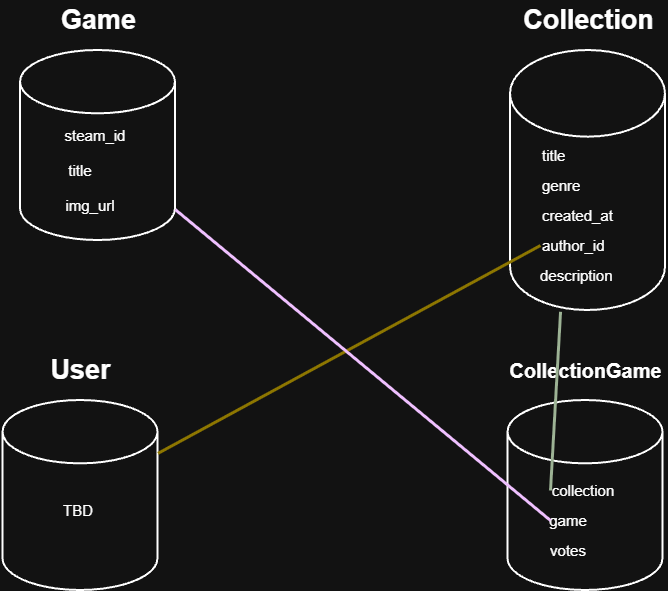

# RankifyGames

Вебплатформа, що спеціалізується на відеоіграх, а саме на їх порівнянні та визначенні найкращої з найкращих. Користувачі можуть створювати з ігор спеціальні колекції за темами, наприклад: "Best Assassin's Creed Game", "The Witcher trilogy", "GTA franchise".

У колекції відповідно буде можливість додавати ігри, і найголовніше - обирати з них найкращу. У користувачів буде можливість віддати один голос за одну гру в кожній такій категорії, і таким чином спільнота зможе обрати найкращу частину серед тієї чи іншої серії ігор. 

Також про кожну гру відображатиметься короткий опис через відкритий Steam API. Пошук та список ігор для додавання в списки також буде реалізовано через Steam API.

---

## Схема бази даних



```text
Game (steam_id, title, img_url(для швидкодії))
Collection (title, genre, created_at, author_id(ForeignKey), description)
CollectionGame (collection(ForeignKey), game(ForeignKey), votes)
User (TBD)
```

---

## REST API

Дані передаються у форматі JSON.

### Колекції

| Метод | Адреса | Що робить | Тіло запиту | Відповідь |
|---|---|---|---|---|
| GET | `/collections/` | список колекцій (`?search=`) | немає | `200`, список колекцій |
| POST | `/collections/` | створити колекцію | `{ "title", "genre", "description" }` | `201`, колекція; `400` |
| GET | `/collections/{id}/` | деталі колекції з іграми й голосами | немає | `200`; `404` |
| PATCH | `/collections/{id}/` | редагувати (*TODO: лише автор*) | будь-які поля колекції | `200`; `404` |
| DELETE | `/collections/{id}/` | видалити (*TODO: лише автор*) | немає | `204`; `404` |

### Ігри

| Метод | Адреса | Що робить | Тіло запиту | Відповідь |
|---|---|---|---|---|
| POST | `/collections/{id}/games/` | додати гру зі Steam у колекцію | `{ "steam_id" }` | `201`; `404`; `409` |
| POST | `/collections/{id}/votes/` | проголосувати за гру | `{ "game_id" }` | `201`, `{ "game_id", "votes" }`; `409`|
| GET | `/games/` | список доданих ігор | немає | `200` |
| GET | `/games/{id}/` | інформація про гру | немає | `200`; `404` |
| GET | `/steam/games/?search=` | пошук гри у Steam | немає | `200`, список ігор |

### Автентифікація

*TBD*
